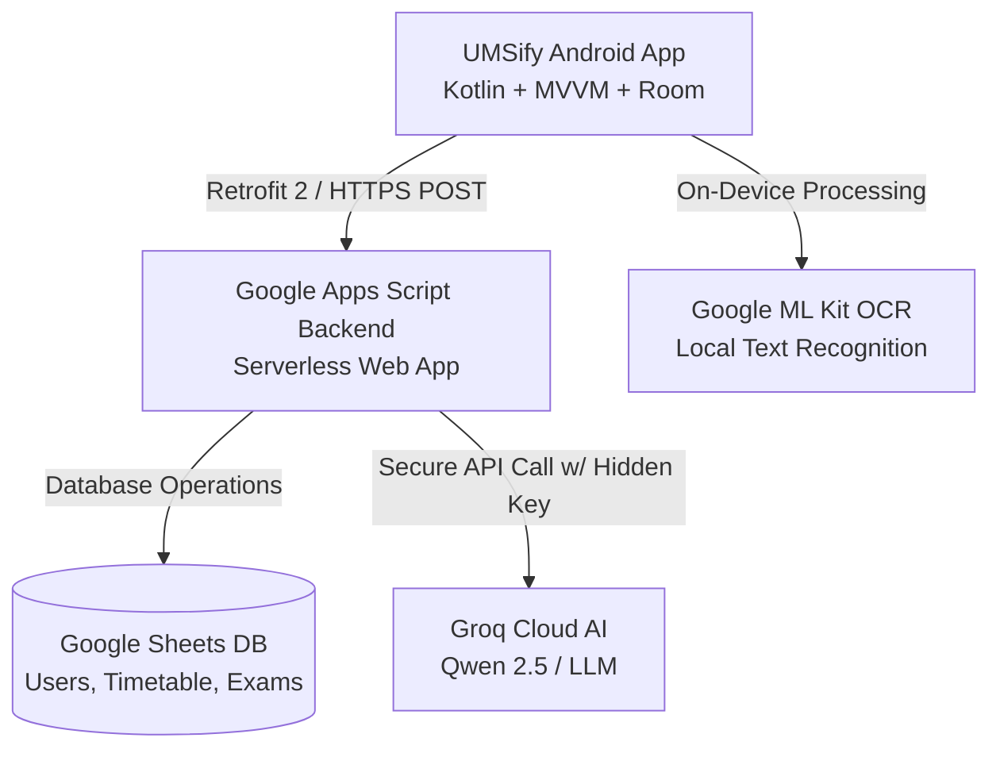

# UMSify 📱⚡

[](https://developer.android.com/)
[](https://kotlinlang.org/)
[](https://developer.android.com/)
[](https://developer.android.com/)
[](https://developers.google.com/apps-script)
[](https://groq.com/)

> **UMSify** is a modern, high-performance, and privacy-focused academic companion designed for university students. It transforms complex academic portals into an intuitive, offline-first experience with instant timetable schedules, live exam countdowns, on-device OCR scanning, home screen widgets, and an AI academic advisor.

---

## 🚀 Download & Install App

You can install and use the latest release of UMSify directly on your Android device:

[](https://drive.google.com/file/d/1CYqQtYZ8N5_lM50alc7eQwjboJPm3Odc/view?usp=sharing)

🔗 **Direct App Link:**  
👉 **[https://drive.google.com/file/d/1CYqQtYZ8N5_lM50alc7eQwjboJPm3Odc/view?usp=sharing](https://drive.google.com/file/d/1CYqQtYZ8N5_lM50alc7eQwjboJPm3Odc/view?usp=sharing)**

### Installation Instructions
1. Download the APK file from the Google Drive link above.
2. Tap the downloaded `.apk` file on your Android device.
3. If prompted, enable **"Install from unknown sources"** for your browser or file manager.
4. Complete installation and launch **UMSify**!

---

## ✨ Key Features

- **📅 Smart Timetable Management**
  - Intuitive daily timeline view with subject, room number, faculty, and group tags.
  - Automatic highlighting of ongoing and upcoming classes.
  - Offline-first cache backed by Android Room Database.

- **🎯 Exam Date Sheet & Real-Time Countdown**
  - Complete schedule of mid-term and end-term examinations.
  - Precision live countdown timer showing remaining days, hours, and minutes for each exam.
  - Detailed room and shift timings.

- **📸 On-Device OCR Scanner (Local AI)**
  - Seamlessly import schedules from screenshots or PDFs using Google ML Kit Text Recognition.
  - Zero cloud latency and 100% privacy: timetable parsing runs entirely on your device without uploading your personal files to third parties.

- **🤖 AI Academic Assistant**
  - Integrated smart conversational assistant powered by Groq AI (`qwen/qwen3.8-27b`).
  - Ask academic questions, exam preparation tips, class timing summaries, and timetable analysis.

- **📱 Interactive Home Screen Widgets**
  - Glanceable widgets for both **Next Class** and **Upcoming Exam**.
  - Automatic periodic background refresh using Android WorkManager.

- **🔒 Zero-Credential Client Security**
  - Third-party API keys (e.g. Groq AI) and master credentials are never stored in the Android APK.
  - Serverless bridge powered by Google Apps Script ensures complete credential isolation.
  - Passwords and session tokens are securely protected using SHA-256 and salted hashing.

---

## 🏗️ Architecture & Technology Stack



### Core Technologies
- **Platform:** Android (API 24 to 34)
- **Language:** Kotlin 1.9
- **Architecture:** Clean Architecture + MVVM (Model-View-ViewModel) + Repository Pattern
- **Local Database:** Jetpack Room SQLite Database
- **Networking:** Retrofit 2 + OkHttp 3 + Gson
- **Asynchronous Processing:** Kotlin Coroutines & Flow
- **Background Tasks:** AndroidX WorkManager
- **On-Device Vision:** Google ML Kit Text Recognition
- **UI & UX:** Google Material Design 3, ViewBinding, ViewPager2, Custom Neon Dark Theme
- **Backend:** Google Apps Script (Serverless Web App)
- **Cloud Database:** Google Sheets API
- **AI Engine:** Groq Cloud API

---

## 🛠️ Project Structure

```text
UMSify/
├── app/
│   ├── src/main/java/com/umsify/app/
│   │   ├── admin/           # Admin screen & instrumentation
│   │   ├── data/
│   │   │   ├── local/       # Room Database, DAOs, Document Parsers
│   │   │   ├── model/       # Data classes & DTOs
│   │   │   ├── remote/      # Retrofit client & API interfaces
│   │   │   └── repository/  # Auth & Data Repositories
│   │   ├── exam/            # Exam data structures & countdowns
│   │   ├── telemetry/       # Diagnostic telemetry
│   │   ├── ui/              # Activities & ViewModels (Auth, Timetable, Exam, AI)
│   │   ├── utils/           # TimeUtils, HashUtils, SessionManager
│   │   └── widget/          # App Widgets & WorkManager periodic sync
│   └── src/main/res/        # Layouts, Drawables, Themes, Widgets
├── backend/
│   ├── Code.gs              # Production Google Apps Script Backend
│   └── README.md            # Backend deployment and setup instructions
├── build.gradle.kts         # Root Gradle build configuration
├── local.properties.example # Environment configuration template
└── README.md                # Project documentation
```

---

## ⚙️ Building from Source

### Prerequisites
- [Android Studio Hedgehog](https://developer.android.com/studio) or newer
- JDK 17
- Android SDK Platform 34

### Step 1: Clone the Repository
```bash
git clone https://github.com/tejashr94/UMSify.git
cd UMSify
```

### Step 2: Configure Environment Variables
Copy the template configuration file:
```bash
cp local.properties.example local.properties
```

Edit `local.properties` to specify your Android SDK directory and your deployed backend URL:
```properties
sdk.dir=C\:\\Users\\<YourUsername>\\AppData\\Local\\Android\\Sdk
APPS_SCRIPT_URL=https://script.google.com/macros/s/<YOUR_DEPLOYMENT_ID>/exec
```

> **Note:** To set up your own serverless backend in under 5 minutes, follow the comprehensive guide in [`backend/README.md`](backend/README.md).

### Step 3: Compile and Build
Build the debug APK using Gradle:
```bash
# On Linux / macOS:
./gradlew assembleDebug

# On Windows:
.\gradlew.bat assembleDebug
```

The output APK will be generated at `app/build/outputs/apk/debug/app-debug.apk`.

---

## 🔒 Security & Privacy

1. **No Sensitive Keys in Version Control:**
   - Deployed Google Apps Script endpoints and Groq API keys are completely excluded from git tracking.
   - `local.properties` is protected via `.gitignore`.
2. **Offline-First Resilience:**
   - All critical timetable and exam data is cached locally inside an encrypted/sandboxed SQLite database via Room.
3. **On-Device OCR:**
   - Uploaded schedule images are parsed entirely on your device with Google ML Kit without sending sensitive documents to external servers.

---

## 📄 License & Attribution

Developed with ❤️ by **Tejash Rai** ([@tejashr94](https://github.com/tejashr94)).  
This project is open-source and intended for educational and student productivity purposes.
